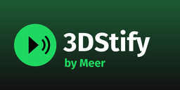
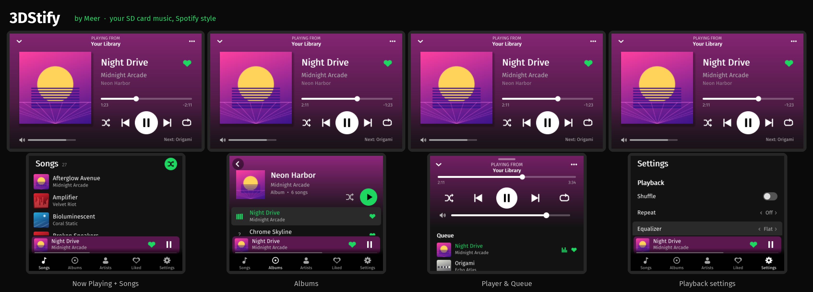
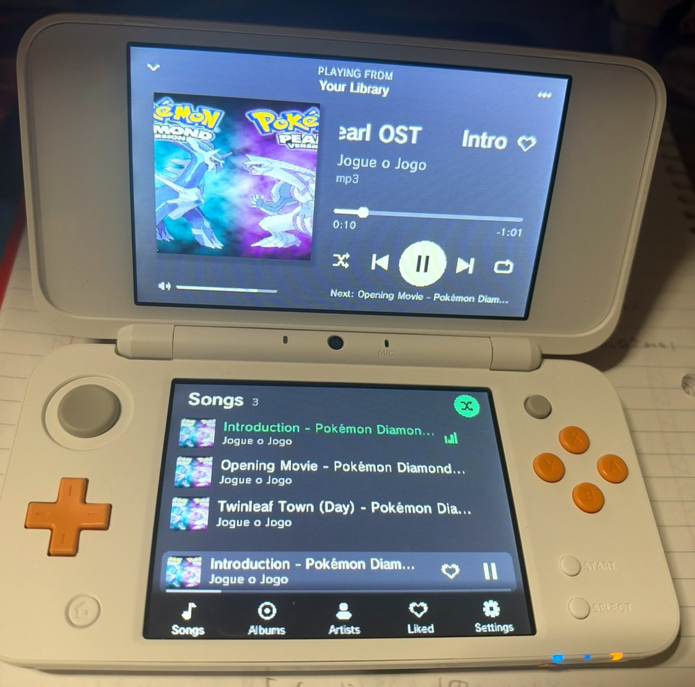
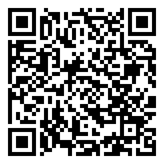

# 3DStify by Meer

**A Spotify-style MP3 player for the Nintendo 3DS**

Plays the music on your SD card · album art · shuffle & repeat · queue · equalizer · sleep timer

Running on real hardware (New Nintendo 2DS XL)

---

## Install

### QR code (fastest)

On your 3DS open **FBI > Remote Install > Scan QR Code** and point the camera at this:

### Manual

1. Download `3DStify.cia` from the [latest release](https://github.com/meerok/Meer-3DStify/releases/latest).
2. Copy it to your SD card.
3. Open FBI, find the file and choose **Install CIA**.

3DStify then shows up on your HOME Menu.

### Homebrew Launcher (.3dsx)

Copy `3DStify.3dsx` from the [latest release](https://github.com/meerok/Meer-3DStify/releases/latest) to `sdmc:/3ds/` and open it from the Homebrew Launcher.

> **Before you start:** you need custom firmware (Luma3DS) and a DSP dump. Run **DSP1** once so `sdmc:/3ds/dspfirm.cdc` exists, otherwise homebrew has no sound.

---

## Adding music

Copy `.mp3` files **anywhere** on your SD card, for example `sdmc:/Music/Artist/Album/01 Song.mp3`. 3DStify scans the whole card the first time it starts and remembers the result, so later launches are instant. Added more songs? Go to **Settings > Rescan music**.

**Only want one folder?** Some games and homebrew keep their own MP3s on the SD card. To keep them out of your library, go to **Settings > Music folder**, browse to your music folder (for example `Music`) and tap **Use this folder**. 3DStify then only shows songs inside that folder and its subfolders. To go back, choose **Use the whole SD card**.

- Song titles, artists, albums and track numbers come from the ID3 tags (ID3v2.2/2.3/2.4 and ID3v1). Untagged files use the file and folder names.
- Album art comes from the cover embedded in the MP3, or a `cover.jpg` / `folder.jpg` (or any JPG/PNG) in the album folder.

## Features

| | |
|---|---|
| 🎧 **Now Playing** | Big cover art, scrolling titles, a live progress bar and Spotify-style controls on the top screen. The background takes its colour from the album art |
| 📚 **Your library** | Songs, Albums, Artists and Liked Songs tabs with album and artist pages, all with smooth touch scrolling |
| ▶️ **Mini player & queue** | A mini player sits above the tabs. Tap it (or swipe up) for the full player with a seek bar, volume slider and the queue |
| 🔀 **Shuffle & repeat** | Shuffle, Repeat All and Repeat One work exactly like Spotify, including "previous restarts the song after 3 seconds" |
| 💚 **Liked Songs** | Tap the heart or press X to save a song |
| 🎚️ **Equalizer** | Flat, Bass Boost, Bass Reducer, Treble Boost and Vocal Boost, done on the 3DS's DSP |
| 🌙 **Sleep timer** | 15, 30, 45 or 60 minutes, or stop at the end of the song |
| 🔒 **Lid closed** | Keeps playing with the lid shut and switches the screens off to save battery |
| 💾 **Resume** | Opens where you left off: same song, same spot, same queue |
| ✨ **No clicks** | Pausing, seeking and skipping fade in and out smoothly |

## Controls

| Button | Action |
|---|---|
| Touch | Everything: tap songs, tabs, hearts and buttons; drag lists to scroll |
| D-Pad ▲ ▼ | Move through the list |
| D-Pad ◀ ▶ | Switch tabs (in Settings: change the selected option) |
| A | Play / open |
| B | Back |
| Y | Play / pause |
| X | Like / unlike the current song |
| L / R | Previous / next song |
| Circle Pad ◀ ▶ | Hold to seek backwards / forwards |
| Circle Pad ▲ ▼, ZL / ZR | Volume |
| SELECT | Screens off (any button turns them back on) |
| START | Exit |

## Files on your SD card

| File | What it is |
|---|---|
| `/3ds/3DStify/library.txt` | The scanned library. Delete it (or use Rescan) to scan again |
| `/3ds/3DStify/liked.txt` | Your Liked Songs |
| `/3ds/3DStify/settings.txt` | Shuffle, repeat, EQ, volume and where you left off |
| `/3ds/3DStify/cache/` | Small album-art thumbnails so lists load fast |

---

## Building from source

Every push to `main` is built by GitHub Actions, which publishes `3DStify.cia` and `3DStify.3dsx` to the latest release.

To build on your own computer:

1. Install [devkitPro](https://devkitpro.org/wiki/Getting_Started) with the 3DS tools, then `sudo dkp-pacman -S 3ds-dev 3ds-mpg123`.
2. Download [stb_image.h](https://github.com/nothings/stb/blob/master/stb_image.h) into `source/`.
3. Put [makerom](https://github.com/3DSGuy/Project_CTR/releases) and [bannertool](https://github.com/diasurgical/bannertool/releases) on your PATH.
4. Run `make cia`.

The screenshots are rendered from the real UI code on a PC: see `tools/preview`.

Built with libctru, citro2d, libmpg123 and stb_image.

## Credits

Made by **Meer**. 3DStify is a fan-made app and isn't affiliated with or endorsed by Spotify.
